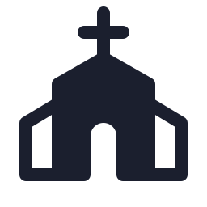

# FreedomCard

A pastel card with a white icon disc at the top and a title and one sentence at the bottom.

**Provide** an `<li class="ds-freedom sky|butter|blush|mint">` holding a `.ds-icon-disc` with a Phosphor fill icon (`assets/Icons`), a `.ds-freedom-title` and a `<p>`.

**Use** in sets of four, always in the order sky, butter, blush, mint. Text is `ink-on-pastel` (14:1 on every pastel). Hover lifts the card 4px.
**Don't** mix pastels with white cards in one row, or use a pastel as a section ground.

**Group:** Cards

## Markup

```html
<ul class="row" style="list-style:none;margin:0;padding:0;align-items:stretch;gap:16px">
<li class="ds-freedom sky" style="width:230px"><span class="ds-icon-disc"></span><div><h3 class="ds-freedom-title">Use it free</h3><p>For any purpose. No fee and no license key, on Sunday or any other day.</p></div></li>
<li class="ds-freedom butter" style="width:230px"><span class="ds-icon-disc"></span><div><h3 class="ds-freedom-title">Read and change it</h3><p>Every line is on GitHub. Tweak a layout or fix a bug for your team.</p></div></li>
<li class="ds-freedom blush" style="width:230px"><span class="ds-icon-disc"></span><div><h3 class="ds-freedom-title">Run your own copy</h3><p>Host it on your own setup, for your church or ministry.</p></div></li>
<li class="ds-freedom mint" style="width:230px"><span class="ds-icon-disc"></span><div><h3 class="ds-freedom-title">Share it</h3><p>Pass it on to a sister church, or share what you built with everyone.</p></div></li>
</ul>
```
