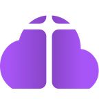

# NavBar

The sticky top bar: lockup, four top links, a GitHub icon and the sign-up pill. Hovering a top link opens a lilac mega-menu.

**Provide** the Logo, the links (Products, Pricing, Resources, Download), the GitHub icon link, and a violet PillButton “Get started for free”. Menus hold `.ds-menu-link` items in sentence case.

**Grounds** `surface` on light pages; `.on-dark` over `surface-stage`; over the purple poster swap the lockup to the ink mark and the button to `.dark`.
**Motion** menus fade and drop 6px in 250ms on `cubic-bezier(.2,.7,.2,1)`. Below 1024px the links collapse into a full-screen list with staggered rows.
**Don't** add more than four top links or put a second button in the bar.

**Group:** Navigation

## Markup

```html
<nav class="ds-nav" aria-label="Main">
  <a class="ds-logo" href="#"><span class="ds-logo-name">Cloud of Worship</span></a>
  <ul class="ds-nav-links"><li><a class="ds-nav-link is-open" href="#">Products</a></li><li><a class="ds-nav-link" href="#">Pricing</a></li><li><a class="ds-nav-link" href="#">Resources</a></li><li><a class="ds-nav-link" href="#">Download</a></li></ul>
  <div class="ds-nav-end"><a class="ds-pill-btn" href="#">Get started for free</a></div>
</nav>
<div style="padding:0 0 0 250px;margin-top:-14px"><div class="ds-menu-panel"><a class="ds-menu-link" href="#">Browser-ready UX</a><a class="ds-menu-link" href="#">Offline-first experience</a><a class="ds-menu-link is-active" href="#">Team Workflow</a><a class="ds-menu-link" href="#">Bible &amp; scripture</a><a class="ds-menu-link" href="#">Songs &amp; hymns</a><a class="ds-menu-link" href="#">Live projection</a><a class="ds-menu-link" href="#">Live transcription</a></div></div>
```
